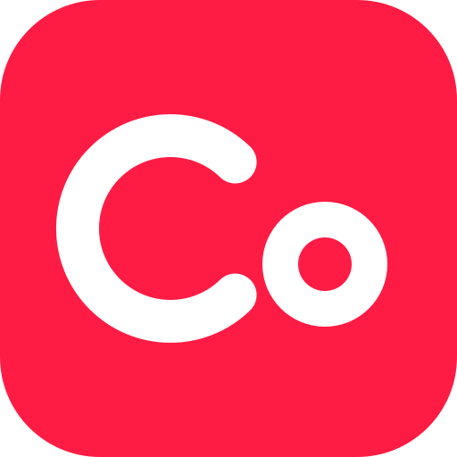
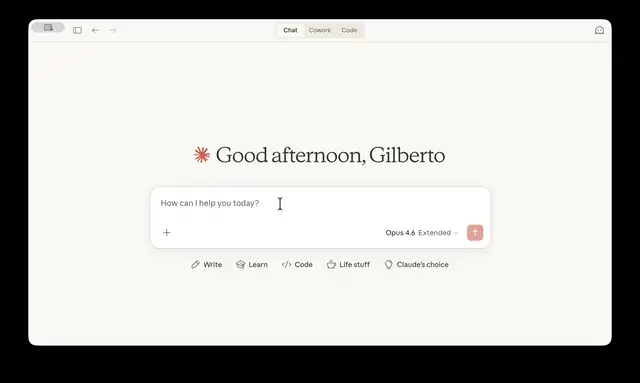

<p align="center">
  
</p>

# cofounder

An AI-powered co-founder that guides you from idea to a web app published on the internet — no programming experience required.

[Clique aqui para a versão em Português](README.md)



## What it does

The cofounder is a set of [skills](skills/) for your coding agent (Claude Code, Codex, Cursor and others). It talks to you in plain language, writes the product spec with you, builds the app, tests it, and deploys it to Locaweb Cloud.

## Installation

Open a terminal in the folder where you want to create your project and run:

```bash
/bin/bash -c "$(curl -fsSL https://cofounder.locaweb.com.br/install.sh)"
```

The script is idempotent (safe to run again) and:

- installs the development tools (mise, Podman, GitHub CLI and others);
- installs the cofounder skills into the project via [`npx skills`](https://github.com/vercel-labs/skills);
- configures your agent to load the cofounder at the start of every session.

Then open your agent in the same folder (for example, run `claude`) and say hi.

### As a Claude Code plugin

Inside Claude Code, run:

```
/plugin marketplace add locaweb/cofounder
/plugin install cofounder@locaweb
```

To get updates automatically, turn on auto-update in `/plugin` → **Marketplaces** → **locaweb** → **Enable auto-update**. To update manually, run `claude plugin update cofounder@locaweb` in your terminal.

### As a Codex plugin

In your terminal, add the marketplace:

```
codex plugin marketplace add locaweb/cofounder
```

Then open `codex`, run `/plugins`, install **cofounder** from the **locaweb** marketplace and start a new session. In your first session, approve the cofounder hook in `/hooks`: it activates the cofounder at the start of every session. Also in the first session, the cofounder asks for your approval once to configure the project (`.codex/config.toml` with full access, and the folder marked as trusted in Codex), so it can install tools and run commands without asking every time; this takes effect from the next session. To update, run `codex plugin marketplace upgrade locaweb`.

## Use cases

- **"I have an idea for an app"** — the cofounder asks questions, writes a PRD and proposes the first version.
- **"Run the app on my computer"** — starts the database, backend and frontend locally so you can try it out.
- **"Add a login page" / "fix this bug"** — implements the change with automated tests and checks it visually.
- **"Put it on the internet"** — creates the GitHub repository, the preview and production environments, and deploys to Locaweb Cloud.
- **"Use my own domain"** — configures a custom domain on the production environment.

## Stack

| Layer | Technology |
|-------|------------|
| Backend | Go (`net/http`, `pgx`, `sqlc`) |
| Frontend | React + TypeScript, React Router, Tailwind CSS, shadcn/ui |
| Database | Postgres (Supabase locally, via Podman) |
| Tests | Go tests, Vitest, Playwright |
| Deploy | GitHub Actions → Locaweb Cloud, as a single container |

## Security

The skills are **static files installed locally** in your project: Markdown instructions and shell scripts that you can read before using. They do not download or execute unauthorized remote code. Every command runs on your machine, through your agent and with your permission. The tools installed by `install.sh` come from their official sources, with versions pinned and checksums or signing keys verified.

### Verifying the installation

Each version is published as a [GitHub Release](https://github.com/locaweb/cofounder/releases) with `install.sh`, a tarball of the `skills/` directory and a `SHA256SUMS` file. The artifacts carry provenance attestations proving they were built by the `release.yml` workflow from a specific commit of this repository. To verify them, use an authenticated [GitHub CLI](https://cli.github.com):

```bash
VERSION=v0.26.1
gh release download "$VERSION" --repo locaweb/cofounder --dir "cofounder-$VERSION"
cd "cofounder-$VERSION"
sha256sum -c SHA256SUMS   # on macOS: shasum -a 256 -c SHA256SUMS
gh attestation verify install.sh --repo locaweb/cofounder
gh attestation verify "cofounder-skills-$VERSION.tar.gz" --repo locaweb/cofounder
```

If everything passes, run the verified `install.sh` with `bash install.sh`.

## Support

Found a problem or have a suggestion? Open an issue on [GitHub Issues](https://github.com/locaweb/cofounder/issues).

## Legal

- [Privacy Policy](TODO-privacy-policy-url)
- [Terms of Use](TODO-terms-of-use-url)
- License: Functional Source License (FSL-1.1-ALv2) — see [LICENSE](LICENSE).
